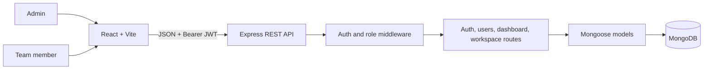

# TalentDesk

A responsive people and account management workspace built with **React, Node.js, Express, and MongoDB**. The welcome screen gives users a clear choice between the Administrator portal and Team member sign-in. The interface adapts to phones, tablets, laptops, and desktop screens.

## Start here (Windows + VS Code)

### 1. Open the project folder

In VS Code choose **File → Open Folder** and open:

```text
C:\Users\HP\Desktop\Growth tech proj 1.0
```

Open **Terminal → New Terminal**. Confirm the terminal is in the project root (the prompt should end with `Growth tech proj 1.0`) and run:

```powershell
Get-ChildItem
```

You should see `client`, `server`, `package.json`, and `README.md`. If you are in a different folder, run:

```powershell
Set-Location "$HOME\Desktop\Growth tech proj 1.0"
```

### 2. Check Node.js

```powershell
node --version
npm --version
```

Use Node.js 20 or newer. If `node` or `npm` is not recognized, install Node.js, reopen VS Code, and retry.

### 3. Start MongoDB

Choose one database option:

- **Local MongoDB:** Start the MongoDB service/application. In PowerShell, you can try `Start-Service MongoDB` (run PowerShell as Administrator only if Windows asks for it). The local connection is `mongodb://127.0.0.1:27017/talentdesk`.
- **MongoDB Atlas:** Create a database and copy its connection URI. Add your current IP to Atlas Network Access and replace `<password>` in the URI with the database user's password. Put the URI in `server/.env` as `MONGODB_URI`.

### 4. Create and configure environment files

Run this command once from the project root. It leaves an existing private `.env` file untouched:

```powershell
if (-not (Test-Path server/.env)) { Copy-Item server/.env.example server/.env }
```

Open `server/.env` in VS Code and set these values:

```env
MONGODB_URI=mongodb://127.0.0.1:27017/talentdesk
JWT_SECRET=replace-with-a-long-random-private-secret
ADMIN_NAME=Your Name
ADMIN_EMAIL=your-admin@example.com
ADMIN_PASSWORD=choose-a-private-password
```

Keep `.env` private and never commit it. The admin password is stored in MongoDB as a bcrypt hash. Optional frontend API configuration is in `client/.env.local`; the default already points to the local API.

### 5. Install project packages

Run from the project root:

```powershell
npm install
npm install --prefix server
npm install --prefix client
```

### 6. Create or update the admin account

```powershell
npm run seed
```

The seed command creates the administrator using `ADMIN_EMAIL` and `ADMIN_PASSWORD`. If that email already exists, it sets that account to admin/active and updates its password to the value currently in `server/.env`.

### 7. Start the app

```powershell
npm run dev
```

Keep this terminal open. It starts the React frontend and Express API together.

- Welcome screen: <http://localhost:5173>
- Admin sign-in: <http://localhost:5173/admin/login>
- Team member sign-in: <http://localhost:5173/login>
- Register a team member: <http://localhost:5173/register>
- API health: <http://localhost:5000/api/health>

After changing environment variables, stop the running command with **Ctrl+C** and run `npm run dev` again. If the page appears stale, refresh with **Ctrl+Shift+R**.

## First use

1. From the welcome screen, choose **Administrator**.
2. Sign in with the admin email and password from `server/.env`.
3. Open **People → Add a person** to create a team member. Set Role to **Team member**.
4. To add another admin, use the same form and set Role to **Administrator**.
5. Click the workspace name in the sidebar to edit it. The name is saved in MongoDB and shared with signed-in team members.
6. Use a person's row menu to edit details, change active status, or delete the account (with confirmation).

## Features

- Email/password registration and login with bcrypt password hashing and 7-day JWT sessions
- Separate admin entry screen and role-based access checks in both React and the API
- Dashboard totals for all, active, inactive, and admin accounts, plus recent users
- User CRUD, role/status changes, name/email search, status filters, pagination, and CSV export
- Editable shared workspace name, saved in MongoDB
- Form validation, error/empty/loading states, responsive navigation, and delete confirmation
- Warm dark charcoal interface with terracotta and sage accents

## Architecture



### Project structure

```text
Growth tech proj 1.0/
├── client/
│   ├── index.html
│   ├── vite.config.js
│   └── src/
│       ├── components/       Start screen, layout, guards, forms, error boundary
│       ├── context/          Current user and JWT session state
│       ├── services/         Fetch client for the Express API
│       ├── App.jsx           Routes, dashboard, people directory, account pages
│       ├── main.jsx          React entry point and providers
│       └── styles.css        Theme and responsive layouts
├── server/
│   └── src/
│       ├── config/           Reserved for shared server configuration
│       ├── middleware/       JWT verification and role authorization
│       ├── models/           User and Workspace Mongoose schemas
│       ├── routes/           Auth, user CRUD, dashboard, workspace REST routes
│       ├── scripts/          Admin seed command
│       └── server.js         Express setup and MongoDB connection
├── docs/
│   ├── ADMIN_GUIDE.md        Admin, people and workspace instructions
│   ├── API.md                API request/response reference
│   └── DEMO.md               Demo walkthrough
├── package.json              Root start/build/seed commands
└── README.md
```

The `server/src/config/` directory is a planned extension point; environment configuration is currently loaded by `dotenv` in `server.js` and the seed script.

## MongoDB collections

### `users`

- `name`, unique lowercase `email`
- `password`: bcrypt hash (never returned by normal queries)
- `role`: `admin` or `user`
- `status`: `active` or `inactive`
- `avatarColor`, `createdAt`, `updatedAt`

### `workspaces`

- `key`: unique primary workspace identifier
- `name`: shared display name (2–50 characters)
- `createdAt`, `updatedAt`

## API overview

Base URL: `http://localhost:5000/api`. Protected requests use `Authorization: Bearer <token>`.

| Method | Endpoint | Access | Purpose |
|---|---|---|---|
| GET | `/health` | Public | API and MongoDB status |
| POST | `/auth/register` | Public | Create a regular account |
| POST | `/auth/login` | Public | Email/password login; returns app JWT |
| GET | `/auth/me` | Signed in | Return current account |
| GET | `/users?page=1&limit=8&search=&status=all` | Admin | Search/filter/paginate accounts |
| POST | `/users` | Admin | Create a user or another admin |
| GET | `/users/:id` | Admin | Read an account |
| PUT | `/users/:id` | Admin | Edit account, role, status or password |
| DELETE | `/users/:id` | Admin | Delete an account |
| GET | `/dashboard/stats` | Admin | Dashboard totals and recent users |
| GET | `/workspace` | Signed in | Read shared workspace name |
| PUT | `/workspace` | Admin | Update shared workspace name |

Full endpoint details are in [docs/API.md](docs/API.md). Admin workflows are in [docs/ADMIN_GUIDE.md](docs/ADMIN_GUIDE.md).

## Common setup issues

- **`npm run dev` says missing packages:** rerun the three install commands from Step 5 in the project root.
- **Mongo connection error:** confirm MongoDB is running, or check the Atlas URI, database password, and IP allowlist.
- **White page:** check the VS Code terminal for a Vite error, refresh with **Ctrl+Shift+R**, and confirm you opened the correct `Growth tech proj 1.0` folder.
- **Port already in use:** stop the other process using ports 5173 or 5000, then restart the app.
- **Forgot the seeded admin password:** update `ADMIN_PASSWORD` in `server/.env`, then rerun `npm run seed`.

## Project notes

- The project uses React, Node.js, Express, and MongoDB as requested.
- Google Cloud authentication is not included; sign-in is email/password with app-issued JWTs.
- `.env` files and dependency/build folders are excluded by `.gitignore`.
